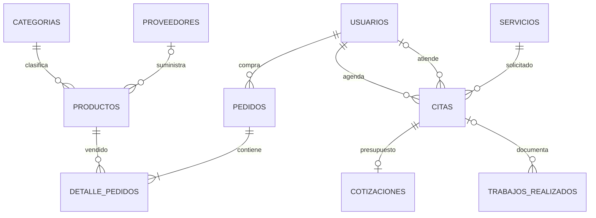

# AlphaBike Frontend

Frontend de AlphaBike construido con React, Vite, JavaScript, Tailwind CSS, Axios y React Router. El proyecto queda preparado para migracion progresiva a TypeScript.

## Variables requeridas

Crea `.env` tomando como base `.env.example`:

```bash
VITE_API_URL=http://localhost:8080/api/v1
```

## Instalar y ejecutar

```bash
npm install
npm run dev
```

La app local queda normalmente en `http://localhost:5173`.

## Build, tests y TypeScript

```bash
npm run lint
npm run typecheck
npm test -- --run
npm run build
npm audit --audit-level=high
```

## Base del frontend y Avance 2 - Semana 14

- Configuracion del entorno: Vite + React, npm, scripts de desarrollo/build/lint/test/typecheck y variable `VITE_API_URL`.
- Estructura modular: `components`, `components/ui`, `context`, `hooks`, `pages`, `api`, `utils` y `types`.
- Navegacion: rutas publicas, rutas de cliente, rutas de encargado, rutas de administrador y pagina 404.
- Gestion de estado: `AuthContext` para sesion y `CarritoContext` para carrito reactivo persistido en `localStorage`.
- UI y estilos: Tailwind CSS, diseno responsive, navbar mobile, formularios con validaciones y componentes reutilizables.
- Consumo API REST: GET en tienda, servicios, galeria, pedidos y citas; POST en registro, login, citas, pedidos y formularios administrativos.
- Estados de interfaz: carga, error, vacio y exito con componentes compartidos.
- Control de versiones/documentacion: README, `.gitignore`, `.env.example`, Dockerfile y configuracion de tests.

## Flujo Git recomendado

Para evidenciar control de versiones en la presentacion:

```bash
git checkout -b develop
git checkout -b feature/frontend-avance-1
git add .
git commit -m "feat(frontend): mejorar avance 1 con api y ux responsive"
```

Usar commits semanticos como:

- `feat(frontend): conectar servicios con api`
- `fix(frontend): validar formulario de checkout`
- `docs(frontend): documentar ejecucion del proyecto`

## Funcionalidad conectada a API

- Home consume `/productos` y `/trabajos/destacados`.
- Servicios consume `/servicios`.
- Galeria consume `/trabajos`.
- Tienda consume `/productos` y `/categorias`, con busqueda, categoria y ordenamiento.
- Checkout crea pedidos en `/pedidos` y registra pagos sandbox en `/pagos`. Si el pago falla, cancela el pedido pendiente para devolver el stock reservado. El backend vuelve a validar propietario, estado, importe exacto y duplicados.

## Pagos

`VITE_PAYMENT_GATEWAY_PROVIDER=SANDBOX` habilita solamente una simulacion academica; no mueve dinero real. Cualquier proveedor distinto falla de forma explicita hasta que se integre su SDK y la verificacion segura en el backend. Las llaves secretas nunca deben guardarse en variables `VITE_*`.

## Docker

El Dockerfile sirve la build con Nginx. Con `alphabike-backend` y `alphabike-frontend` clonados como carpetas hermanas, ejecuta desde `alphabike-backend`:

```bash
docker compose up --build
```

Servicios:

- Frontend: `http://localhost:5173`
- Backend: `http://localhost:8080`

## Rutas por rol

- `CLIENTE`: carrito, checkout, pedidos, citas y perfil.
- `ENCARGADO`: dashboard, citas, productos, venta presencial, entregas, pagos y galeria interna.
- `ADMIN`: dashboard, usuarios, citas, productos, pedidos, pagos, categorias, servicios y reportes.


## Tiempo real con WebSockets

Configura `.env` antes de arrancar Vite:

```properties
VITE_API_URL=http://localhost:8080/api/v1
VITE_WS_URL=ws://localhost:8080/ws/citas
VITE_PAYMENT_GATEWAY_PROVIDER=SANDBOX
```

`VITE_WS_URL` es opcional: si se omite se deriva del origen de VITE_API_URL. Usar `wss://` si la web usa HTTPS. Las variables VITE se fijan al compilar. El backend debe permitir el origen real del frontend en CORS_ALLOWED_ORIGINS y WS_ALLOWED_ORIGINS.

RealtimeProvider mantiene una conexión autenticada por sesión. Envía AUTH, solicita SYNC, comprueba PING/PONG y reintenta fallos de red entre 1 y 15 segundos. Tras reconectar, CITAS_SYNC vuelve a consultar el estado actual de la BD. Al salir se cierra el socket y se limpia la caché privada.

Las pantallas Mis citas, Detalle de cita, Gestión de citas y sus equivalentes de administración reaccionan a CITA_UPDATED sin recargar. La interfaz muestra «Citas en vivo», reconexión o sesión expirada. El cliente no puede cambiar citas por mensajes WebSocket: las mutaciones requieren los endpoints REST autorizados.

## Modelo de datos



Los pagos apuntan a pedido o cotización por tipo e ID; se validan en servicio y tienen unicidad de pago confirmado en PostgreSQL.

El modelo detallado y el protocolo están en `docs/diagrama-er.md` y `docs/avance-2.md` del repositorio hermano **alphabike-backend**.

## Demostración del Avance 2

1. Levantar PostgreSQL y backend siguiendo el README de alphabike-backend; ejecutar este cliente con `npm ci` y `npm run dev`.
2. Como ADMIN, demostrar crear, consultar, editar y eliminar un servicio sin citas asociadas. Crear un CLIENTE y un ENCARGADO desde Gestión de usuarios.
3. Abrir dos sesiones separadas (una privada): cliente en `/citas` y encargado en `/encargado/citas`. Agendar una cita futura.
4. Cambiar el estado desde el encargado y observar la actualización inmediata del cliente. Mostrar los frames WS en DevTools, ocultando el token AUTH.
5. Interrumpir la red y restaurarla; comprobar reconexión y reconciliación del estado. Reiniciar el backend con la misma BD para mostrar persistencia.
6. Explicar el flujo React → Axios → Controller → Service → Repository → PostgreSQL → commit → WebSocket → actualización de interfaz.

Las pruebas `citasSocket.test.js` cubren autenticación por frame, sincronización, recepción de cambios, reconexión, rechazo de credenciales y limpieza al salir. El backend añade pruebas de conexiones WebSocket reales y CRUD por rol.

## Control de versiones

La versión del Avance 2 se mantiene en `main`. El historial conserva commits semánticos y pull requests para revisar los cambios. La exposición oral es parte de la entrega del equipo y debe demostrar CRUD, persistencia y eventos en tiempo real.

## Sincronizacion y contacto

Las mutaciones de categorias, productos, stock y galeria invalidan las consultas relacionadas del catalogo, incluidos detalles de producto. Compras, ventas y cancelaciones administrativas tambien invalidan el stock publicado. `CatalogoSync.test.jsx` verifica la navegacion entre panel y tienda sin recargar desde ADMIN y ENCARGADO.

El formulario Contacto prepara un mensaje completo para el numero de WhatsApp mostrado. El usuario revisa y envia el mensaje desde WhatsApp; la web conserva el borrador y no afirma que se haya entregado. No se almacena como ticket ni se envia correo desde ese formulario. `Contacto.test.jsx` verifica este comportamiento sin contactar al servicio externo.

Las cuentas registradas publicamente deben verificar su correo antes de iniciar sesion; el backend requiere SMTP configurado para entregar los enlaces. En una demostracion sin SMTP, el administrador puede crear usuarios desde su panel.

## Inventario adaptable

ADMIN y ENCARGADO comparten `InventarioProductos.jsx`. En movil muestra tarjetas con nombre, categoria, proveedor, precio, minimo, stock y acciones; en pantallas amplias usa una tabla con desplazamiento horizontal interno si hace falta. Los controles de stock incluyen etiqueta accesible y la descontinuacion se ofrece solamente al administrador.

## Venta presencial y recuperacion

La venta interna usa una sola llamada a `/pedidos/venta-presencial`; el importe del pago lo calcula el backend. Antes de enviarla se conserva un UUID y el borrador en sessionStorage, separados por usuario. Si se pierde la respuesta, la interfaz bloquea cambios y permite reintentar la confirmacion con el mismo UUID, incluso tras recargar esa pestana. Un rechazo 4xx permite corregir el borrador; la confirmacion satisfactoria limpia la operacion pendiente. Cerrar la pestana elimina sessionStorage: para continuar desde otra pestana debe revisarse primero la lista de pedidos.

Pagos e historial usan campos etiquetados en movil. El historial distingue Total pagado en pedidos de pedidos pendientes/cancelados y conserva los centimos.
