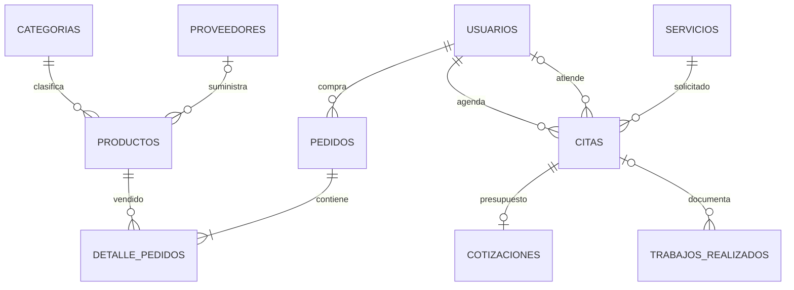

# AlphaBike Frontend

Frontend de AlphaBike construido con React, Vite, JavaScript, Tailwind CSS, Axios y React Router. El proyecto queda preparado para migracion progresiva a TypeScript.

## Persistencia SQL y NoSQL

Los detalles de cita de cliente, encargado y administrador muestran un historial persistente almacenado en MongoDB mediante la API autenticada. PostgreSQL conserva las operaciones de negocio. El historial se actualiza cada cinco segundos y admite reintento y paginacion; una interrupcion de MongoDB se muestra como error recuperable, sin ocultar la cita. No se ponen credenciales MongoDB en variables `VITE_*`.

Configuracion de ambos motores y prueba reproducible en [documentacion del backend](https://github.com/ITP89/alphabike-backend/blob/master/docs/persistencia-sql-nosql.md).

## Entornos publicados

- [Tienda principal](https://alphabike-frontend.vercel.app) en Vercel, desde `main`, con API en [Render](https://alphabike-backend.onrender.com/api/v1/servicios).
- [Tienda de pruebas de Mercado Pago](https://alphabike-pagos-pruebas.onrender.com), con su propio backend y base de datos. Crea allí una cuenta de cliente para la demostración.

## Variables requeridas

Crea `.env` tomando como base `.env.example`:

```bash
VITE_API_URL=http://localhost:8080/api/v1
```

## Instalar y ejecutar

```bash
npm install
npm run dev
```

La app local queda normalmente en `http://localhost:5173`.

## Build, tests y TypeScript

```bash
npm run lint
npm run typecheck
npm test -- --run
npm run build
npm audit --audit-level=high
```

## Base del frontend y Avance 2 - Semana 14

- Configuracion del entorno: Vite + React, npm, scripts de desarrollo/build/lint/test/typecheck y variable `VITE_API_URL`.
- Estructura modular: `components`, `components/ui`, `context`, `hooks`, `pages`, `api`, `utils` y `types`.
- Navegacion: rutas publicas, rutas de cliente, rutas de encargado, rutas de administrador y pagina 404.
- Gestion de estado: `AuthContext` para sesion y `CarritoContext` para carrito reactivo persistido en `localStorage`.
- UI y estilos: Tailwind CSS, diseno responsive, navbar mobile, formularios con validaciones y componentes reutilizables.
- Consumo API REST: GET en tienda, servicios, galeria, pedidos y citas; POST en registro, login, citas, pedidos y formularios administrativos.
- Estados de interfaz: carga, error, vacio y exito con componentes compartidos.
- Control de versiones/documentacion: README, `.gitignore`, `.env.example`, Dockerfile y configuracion de tests.

## Flujo Git recomendado

Para evidenciar control de versiones en la presentacion:

```bash
git checkout -b develop
git checkout -b feature/frontend-avance-1
git add .
git commit -m "feat(frontend): mejorar avance 1 con api y ux responsive"
```

Usar commits semanticos como:

- `feat(frontend): conectar servicios con api`
- `fix(frontend): validar formulario de checkout`
- `docs(frontend): documentar ejecucion del proyecto`

## Funcionalidad conectada a API

- Home consume `/productos` y `/trabajos/destacados`.
- Servicios consume `/servicios`.
- Galeria consume `/trabajos`.
- Tienda consume `/productos` y `/categorias`, con busqueda, categoria y ordenamiento.
- Checkout crea pedidos en `/pedidos` y consulta `/mercado-pago/config` para determinar si debe ofrecer Checkout Pro. En el flujo interno de simulación, registra pagos en `/pagos` y cancela el pedido pendiente si el pago falla.

## Pagos

Mercado Pago Checkout Pro redirige al cliente desde el detalle de su pedido. El backend crea la sesión de pago y verifica el resultado antes de marcar el pedido como **Pagado**. Para la entrega usa la tienda de pruebas y una tarjeta de prueba de Mercado Pago.

`VITE_PAYMENT_GATEWAY_PROVIDER=SANDBOX` corresponde al simulador interno. La disponibilidad de Checkout Pro depende de la configuración del backend. Las credenciales privadas se configuran únicamente en el servidor. Consulta la [guía de Mercado Pago del backend](https://github.com/ITP89/alphabike-backend/blob/master/docs/despliegue-render.md#mercado-pago-checkout-pro-para-pedidos-de-la-tienda).

## Docker

El Dockerfile sirve la build con Nginx. Con `alphabike-backend` y `alphabike-frontend` clonados como carpetas hermanas, ejecuta desde `alphabike-backend`:

```bash
docker compose up --build
```

Servicios:

- Frontend: `http://localhost:5173`
- Backend: `http://localhost:8080`

## Rutas por rol

- `CLIENTE`: carrito, checkout, pedidos, citas y perfil.
- `ENCARGADO`: dashboard, citas, productos, venta presencial, entregas, pagos y galeria interna.
- `ADMIN`: dashboard, usuarios, citas, productos, pedidos, pagos, categorias, servicios y reportes.


## Tiempo real con WebSockets

Configura `.env` antes de arrancar Vite:

```properties
VITE_API_URL=http://localhost:8080/api/v1
VITE_WS_URL=ws://localhost:8080/ws/citas
VITE_PAYMENT_GATEWAY_PROVIDER=SANDBOX
```

`VITE_WS_URL` es opcional: si se omite se deriva del origen de VITE_API_URL. Usar `wss://` si la web usa HTTPS. Las variables VITE se fijan al compilar. El backend debe permitir el origen real del frontend en CORS_ALLOWED_ORIGINS y WS_ALLOWED_ORIGINS.

RealtimeProvider mantiene una conexión autenticada por sesión. Envía AUTH, solicita SYNC, comprueba PING/PONG y reintenta fallos de red entre 1 y 15 segundos. Tras reconectar, CITAS_SYNC vuelve a consultar el estado actual de la BD. Al salir se cierra el socket y se limpia la caché privada.

Las pantallas Mis citas, Detalle de cita, Gestión de citas y sus equivalentes de administración reaccionan a CITA_UPDATED sin recargar. La interfaz muestra «Citas en vivo», reconexión o sesión expirada. El cliente no puede cambiar citas por mensajes WebSocket: las mutaciones requieren los endpoints REST autorizados.

## Modelo de datos



Los pagos apuntan a pedido o cotización por tipo e ID; se validan en servicio y tienen unicidad de pago confirmado en PostgreSQL.

El modelo detallado y el protocolo están en `docs/diagrama-er.md` y `docs/avance-2.md` del repositorio hermano **alphabike-backend**.

## Demostración del Avance 2

1. Levantar PostgreSQL y backend siguiendo el README de alphabike-backend; ejecutar este cliente con `npm ci` y `npm run dev`.
2. Como ADMIN, demostrar crear, consultar, editar y eliminar un servicio sin citas asociadas. Crear un CLIENTE y un ENCARGADO desde Gestión de usuarios.
3. Abrir dos sesiones separadas (una privada): cliente en `/citas` y encargado en `/encargado/citas`. Agendar una cita futura.
4. Cambiar el estado desde el encargado y observar la actualización inmediata del cliente. Mostrar los frames WS en DevTools, ocultando el token AUTH.
5. Interrumpir la red y restaurarla; comprobar reconexión y reconciliación del estado. Reiniciar el backend con la misma BD para mostrar persistencia.
6. Explicar el flujo React → Axios → Controller → Service → Repository → PostgreSQL → commit → WebSocket → actualización de interfaz.

Las pruebas `citasSocket.test.js` cubren autenticación por frame, sincronización, recepción de cambios, reconexión, rechazo de credenciales y limpieza al salir. El backend añade pruebas de conexiones WebSocket reales y CRUD por rol.

## Control de versiones

La versión del Avance 2 se mantiene en `main`. El historial conserva commits semánticos y pull requests para revisar los cambios. La exposición oral es parte de la entrega del equipo y debe demostrar CRUD, persistencia y eventos en tiempo real.

## Sincronizacion y contacto

Las mutaciones de categorias, productos, stock y galeria invalidan las consultas relacionadas del catalogo, incluidos detalles de producto. Compras, ventas y cancelaciones administrativas tambien invalidan el stock publicado. `CatalogoSync.test.jsx` verifica la navegacion entre panel y tienda sin recargar desde ADMIN y ENCARGADO.

El formulario Contacto prepara un mensaje completo para el numero de WhatsApp mostrado. El usuario revisa y envia el mensaje desde WhatsApp; la web conserva el borrador y no afirma que se haya entregado. No se almacena como ticket ni se envia correo desde ese formulario. `Contacto.test.jsx` verifica este comportamiento sin contactar al servicio externo.

Las cuentas registradas publicamente deben verificar su correo antes de iniciar sesion; la tienda principal usa Resend para enviar los enlaces de verificación y recuperación. En desarrollo puedes configurar SMTP o crear usuarios desde el panel administrativo.

## Inventario adaptable

ADMIN y ENCARGADO comparten `InventarioProductos.jsx`. En movil muestra tarjetas con nombre, categoria, proveedor, precio, minimo, stock y acciones; en pantallas amplias usa una tabla con desplazamiento horizontal interno si hace falta. Los controles de stock incluyen etiqueta accesible y la descontinuacion se ofrece solamente al administrador.

## Venta presencial y recuperacion

La venta interna usa una sola llamada a `/pedidos/venta-presencial`; el importe del pago lo calcula el backend. Antes de enviarla se conserva un UUID y el borrador en sessionStorage, separados por usuario. Si se pierde la respuesta, la interfaz bloquea cambios y permite reintentar la confirmacion con el mismo UUID, incluso tras recargar esa pestana. Un rechazo 4xx permite corregir el borrador; la confirmacion satisfactoria limpia la operacion pendiente. Cerrar la pestana elimina sessionStorage: para continuar desde otra pestana debe revisarse primero la lista de pedidos.

Pagos e historial usan campos etiquetados en movil. El historial distingue Total pagado en pedidos de pedidos pendientes/cancelados y conserva los centimos.


## Paneles revisados (11/11/2026)

- Admin y encargado comparten las acciones válidas de pedidos: iniciar preparación, despachar según entrega y confirmar recepción, incluyendo provincia. No se ofrecen despachos de pedidos pendientes o cancelados.
- Los detalles usan precioAcordado y clienteEmail del servidor. Los estados de pago no disponibles se muestran como tales. Los cobros manuales permiten elegir una referencia pendiente y cargan su importe, sin escribir UUID ni monto libremente.
- Usuarios permite editar nombre/teléfono y protege en pantalla al administrador de la sesión y al último administrador activo; la protección definitiva también existe en el servidor.
- Editar un producto no reemplaza su stock. El ajuste se hace desde la columna Stock y envía el valor observado; un conflicto exige actualizar el inventario.
- Citas permite asignar responsable o tomar cita libre; filtra estados disponibles y bloquea cotizaciones/cobros en citas cerradas. El botón de cobro de taller indica que finaliza el servicio.
- Galería permite crear, editar y eliminar trabajos. Servicios, categorías y galería confirman los borrados definitivos. Formularios impiden doble envío.
- Reportes incluye período de consulta e informa errores parciales, sin presentarlos como cero ventas.
- La agenda usa la fecha de America/Lima y consulta la política opcional del taller. No se inventaron horarios ni capacidad.
- Los modales administrativos se desplazan dentro de la pantalla, contienen el foco, cierran con Escape y devuelven el foco al control de origen. El menú y los controles comparten tamaños legibles y foco visible.
- El simulador identifica los datos comerciales de demostración y advierte que no deben usarse tarjetas ni transferencias reales. Checkout Pro conserva su configuración propia en backend.

Pruebas nuevas: entrega por tipo, precio/correo del pedido, fecha de Lima y reportes parcialmente fallidos. Ejecutar npm test -- --run, npm run lint y npm run build. El backend debe actualizarse junto con esta versión del frontend, especialmente por stockEsperado y referencias-pendientes.


### Consistencia de cobros y pedidos

- El estado del servicio y su pago se consultan por separado. Una cita completada conserva el cobro pendiente de su cotización; las canceladas y las referencias ya pagadas no se ofrecen para cobrar.
- El encargado puede consultar productos, cantidades, destino y guía del pedido antes de avanzar su entrega.
- El cliente puede recuperar el pago simulado de un pedido pendiente existente o solicitar su cancelación. El servidor vuelve a validar propiedad, estado y reserva; una operación asociada a Mercado Pago exige resolver primero su estado remoto.
- Los pagos de consulta incluyen el nombre del cliente y los datos persistidos de operación/tarjeta. Las constancias internas no inventan autorizaciones ni datos fiscales.
- El resumen administrativo distingue Mercado Pago y otros métodos para reconciliar el desglose con los ingresos confirmados. Los pedidos muestran la fecha del contrato HTTP.
